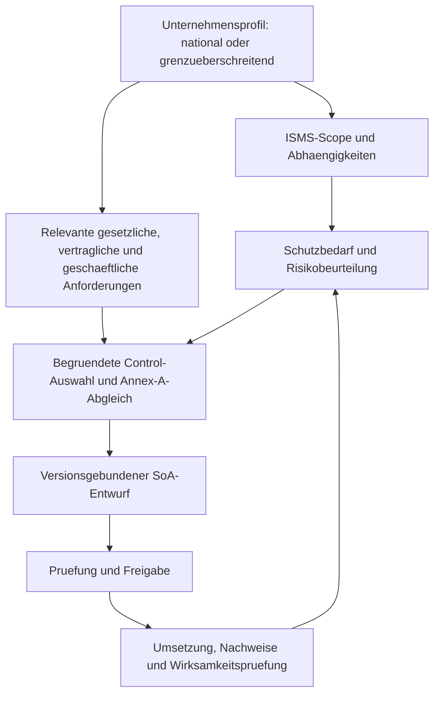

# Fachlicher Zielpfad: Unternehmenskontext bis zur SoA

Recherche: 02.11.2026. Codebasis: Main `b18afb256219f27176ac654b084a82b978a7a3af`.
Bewertung der Architektur und naechsten Implementierungsschritte; keine
Zertifizierungsabnahme und keine individuelle Betroffenheitsentscheidung.

## Ergebnis

ISCY hat geeignete Bausteine fuer einen gemeinsamen Unternehmens- und
Betroffenheits-Wizard. Er muss nationale Unternehmen ebenso wie solche mit
grenzueberschreitenden Taetigkeiten abbilden. Internationalitaet ist ein
Kontextmerkmal, keine Zugangsvoraussetzung. ISO/IEC 27001 richtet sich an
unterschiedliche Organisationsgroessen und Branchen; eine Zertifizierung
ist eine eigene Entscheidung. [ISO-Produktseite](https://www.iso.org/standard/27001)

Ein Unternehmensprofil liefert Eingaben fuer die weitere Beurteilung.
Eine belastbare SoA benoetigt zusaetzlich einen abgegrenzten ISMS-Scope,
Anforderungen und Risikobehandlung. Ein auf der SC27-Ressourcenseite
veroeffentlichter Erlaeuterungsbeitrag
beschreibt notwendige Controls, Aufnahmegruende, Umsetzungsstatus und
begruendete Ausschluesse von Annex-A-Referenzcontrols. Auch eigene Controls
koennen notwendig sein. Die Practice Note ist ein erlaeuternder,
**nicht formal von ISO/SC27 gebilligter** Beitrag, kein Ersatz des
Normtexts. [SC27 SoA Practice Note, insbesondere Seiten 2–5](https://committee.iso.org/files/live/sites/jtc1sc27/files/resources/ISO-IECJTC1-SC27-WG1_N3298_Auditing%20Practices%20Note%20-%20SoA.pdf)

## Empfohlene Datenabhaengigkeiten fuer ISCY

Das ist unser vorgeschlagenes Datenmodell, kein von einer Quelle
uebernommener zwingend linearer Ablauf. Vorhandene Massnahmen und Evidence
koennen bereits waehrend der Beurteilung eingebunden sein. Die
IT-Grundschutz-Methodik unterstuetzt die Betrachtung von Geltungsbereich,
Geschaeftsprozessen, Informationen, Systemen und Schutzbedarf; ihre
Aktivitaeten koennen teilweise parallel erfolgen.
[BSI-Standard 200-2, insbesondere Kapitel 8](https://www.bsi.bund.de/SharedDocs/Downloads/DE/BSI/Grundschutz/BSI_Standards/standard_200_2.pdf?__blob=publicationFile)

Die SoA ist ein Zielartefakt eines ISO-orientierten ISMS-Pfads. Der Wizard
soll ausserdem eine reine Betroffenheitsorientierung erlauben. Das Ziel
(Orientierung, ISO-Readiness oder umfassender ISMS-Aufbau) wird bewusst
gewaehlt; nicht jedes Profil muss automatisch eine SoA erzeugen.

## Nationale und grenzueberschreitende Einordnung

Fuer Deutschland zeigt § 28 BSIG, dass konkrete Einrichtungsarten,
Groessenmerkmale und Sonderfaelle entscheidend sind. Absatz 4 behandelt
Partner-/verbundene Unternehmen einschliesslich einer differenzierten
Ausnahme. Ein simples Schema Land + Sektor + Mitarbeiterzahl genuegt
dafuer nicht. Die abgerufene konsolidierte Gesetzesfassung nennt den
22.10.2026 als letzten Aenderungsstand; historische Wizardregeln sind
somit nicht ungeprueft als aktuelle Rechtslogik zu verwenden.
[BSIG, besonders § 28 und Anlagen 1/2](https://www.gesetze-im-internet.de/bsig_2025/BSIG.pdf)

Auch das BSI bezeichnet seine eigene automatisierte Betroffenheitspruefung
als Orientierung auf Basis von Eigenangaben. Unsere Ableitung fuer ISCY:
Angaben, Regelversion, Begruendung, fehlende Fakten und menschliche
Bestaetigung getrennt speichern; fehlende Angaben ergeben kein negatives
Ergebnis. [BSI-Betroffenheitspruefung](https://betroffenheitspruefung-nis-2.bsi.de/)

Weitere Rahmenwerke brauchen jeweils eigene Sachverhalte. Dies sind
Recherchebeispiele fuer das kuenftige Datenmodell, keine fertigen Regeln:

| Pfad | Zu unterscheidende Angaben | Primaerquelle |
| --- | --- | --- |
| Datenschutz | Verarbeitungstaetigkeit, Rolle, Niederlassung und gegebenenfalls gezieltes Angebot/Beobachtung; eine reine Laenderliste reicht nicht | [EDPB-Leitlinien 3/2018 zu Art. 3 DSGVO](https://www.edpb.europa.eu/documents/guideline/guidelines-32018-on-the-territorial-scope-of-the-gdpr-article-3-version-adopted_en) |
| Finanzsektor | Konkreter Einrichtungs-/Diensttyp; DORA/NIS2-Ueberschneidungen gezielt aufloesen | [Kommissionsleitlinien zur NIS2-Sektorabgrenzung, 2023/C 328/02](https://eur-lex.europa.eu/legal-content/EN/TXT/?uri=CELEX%3A52023XC0918%2801%29) |
| Digitale Produkte | Produkt, Marktbereitstellung, Wirtschaftsakteur und Ausnahmen; nicht nur Software-ja/nein | [EU-Kommission: CRA-Uebersicht](https://digital-strategy.ec.europa.eu/en/policies/cra-summary) |
| KI | Rolle, konkretes System, Verwendungszweck und Risikoeinordnung; Nutzung bedeutet nicht pauschal Hochrisiko | [EU-Kommission: AI Act](https://digital-strategy.ec.europa.eu/en/policies/regulatory-framework-ai) |

Eine SoA ersetzt weder das Anforderungsregister noch saemtliche
Registrierungs-, Melde- oder Produktkonformitaetsnachweise. Fachliche
Normversion und Rechtsstand sind an jede kuenftige Beurteilung zu binden.
ISO fuehrt aktuell ISO/IEC 27001:2022 mit Amendment 1:2024.
[ISO-Produktseite und Aenderungsstand](https://www.iso.org/standard/27001)

## Belegter Implementierungsstand

| Baustein | Im Code vorhanden | Fehlende Verbindung / naechstes Gate |
| --- | --- | --- |
| Profil W1 | Eigene tenantgebundene Entwuerfe; unbekannte Werte bleiben unterscheidbar | Freitext-Laender, Sektor und Groessenbezug fuer W2 strukturiert bestaetigen |
| Organisationsprofil | Stammprofil und deklarierte regulatorische Merkmale | Keine pauschale Gleichsetzung von gesetzten Merkmalen und gepruefter Rechtsentscheidung |
| Risiken | Prozess-/Asset-/Owner-Bezug, Bewertung, Behandlung und Restrisikoannahme in `risk_store.rs` | Beurteilungsstand dem konkreten Scope und der SoA nachvollziehbar zuordnen |
| Anforderungen | Versionierte Mappings und Quellen in `requirement_store.rs` | Exakte Auswahlversion fuer neue SoA festhalten |
| SoA | `generate_soa` erstellt einen separaten DRAFT aus aktiven ISO27001-Requirements; initial alle `is_applicable=true` und `NOT_STARTED` | Kein aus Profil/Scope/Risiken abgeleiteter Auswahlprozess; Vorbelegung ist keine bestaetigte Anwendbarkeit |
| Bindung | `session_id` existiert im SoA-Schema | Der Generator befuellt sie nicht; Profilrevision/Scope-/Risikostand werden nicht gebunden |
| Lebenszyklus | Bearbeitung nur fuer DRAFT, transaktionales Audit | Vollstaendiger Pruef-/Freigabe- und Nachfolgeversionsprozess weiter offen |

Quellen im Repository: `src/company_wizard.rs`, `src/risk_store.rs`,
`src/requirement_store.rs` und `src/soa.rs`, jeweils unter
`rust/iscy-backend/`. Der bestehende
[SoA-Wiederherstellungsvertrag](SOA_RESTORATION_CONTRACT.md) bleibt verbindlich.
Das sind Codebefunde, keine Aussagen ueber produktive Mandantendaten.

### Referenzkatalog vor Vollstaendigkeitsaussagen pruefen

Die mitgelieferte SQLite-Seed-Datei enthaelt **acht aktive ISO27001-
Requirement-Eintraege mit 16 unterschiedlichen expliziten Referenz-IDs** in
`mapped_controls`. Einzelne Eintraege buendeln mehrere Controls. Gezaehlt
wurde ausschliesslich die eingecheckte Seed-Baseline, kein Live-Datenbestand.
Das ist kein Nachweis eines vollstaendigen Annex-A-Abgleichs.

Die aktuelle Referenz umfasst 93 Annex-A-Controls. Notwendige Controls
werden aus dem Kontext bestimmt und gegen diese Referenz abgeglichen;
es folgt daraus keine Pflicht, unterschiedslos alle zu implementieren.
[SC27 Journal 2025, Issue 1, Beitrag ab Seite 18/19](https://committee.iso.org/files/live/sites/jtc1sc27/files/resources/Journal%202025.pdf)

Fuer ISCY folgt daraus: normatives Referenzcontrol, gebuendeltes Mapping,
organisationsspezifisches Control und dessen konkrete Umsetzung getrennt
fuehren. Die ISCY-27-Struktur kann als Arbeitsstruktur dienen; ihre Anzahl
belegt keine ISO-Vollstaendigkeit. Managementsystem-Anforderungen und
Annex-A-Referenzcontrols duerfen nicht zu derselben Ausschlusslogik werden.
Lizenzierter Normtext und dessen Aenderungen bleiben Grundlage der
spaeteren fachlichen Abnahme; Normvolltexte werden hier nicht kopiert.

Die gesonderte [Fachpruefung von ISCY-27](ISCY27_FRAMEWORK_REVIEW.md)
enthaelt die 27-/82-Inventur, konkrete NIS2-Referenzfehler und Grenzen der
Status-/Reifegradkennzahlen. Diese Korrekturen sind ein eigenes Gate vor
der Nutzung der Crosswalks als fachlich verlaessliche Entscheidungsbasis.

## Naechste umsetzbare Meilensteine

1. **W2a – Fakten und Anforderungen:** Einheiten/Beziehungen, Taetigkeiten,
   Rechtsraeume und Ziel des Durchlaufs strukturiert bestaetigen. Je
   Regelwerk versionierte begruendete Indikation, offene Fragen und
   gesonderte menschliche Bestaetigung. Ein nationales Profil ist ein
   vollwertiger Fall; grenzueberschreitende Angaben sind erweiterbar.
2. **W2b – Scope und Risiken:** ISMS-Geltungsbereich, Prozesse, Informationen,
   Assets, Dienstleister und Abhaengigkeiten als eigenen Versionsstand
   festlegen. Risikokriterien, Bewertungen, Behandlung und Verantwortliche
   daran binden; eine Konzern-Groessenberechnung ist nicht automatisch
   der ISMS-Scope.
3. **W2c – Controls und Referenzabgleich:** Vollstaendigkeit der Referenzbasis
   pruefen. Jede Aufnahme/Ausnahme auf konkrete Anforderungen, Risiken
   oder Geschaeftsgruende zurueckfuehren. Organisationsspezifische Controls
   tenantgebunden zulassen und zum Referenzkatalog zuordnen. Ungepruefte
   Vorschlaege ausdruecklich als solche darstellen.
4. **W3 – SoA und Umsetzung:** Entwurf an Profilrevision, Scope-, Risiko-,
   Regel- und Mappingstand binden. Entscheidungen, Umsetzungsstatus,
   Owner und Nachweise dokumentieren. Erst nach fachlicher Pruefung
   freigeben; freigegebene Inhalte einfrieren, Aenderungen als neuen
   zugeordneten Entwurf behandeln. Plan, Restrisikoannahme und
   Wirksamkeitspruefung bleiben eigene belegte Entscheidungen.

Diese Meilensteine sind Vorschlaege aus Recherche und Codeabgleich.
Diese Aenderung implementiert keine neue Rechtsregel oder SoA-Automatik.

## Abnahmefaelle fuer den spaeteren durchgaengigen Ablauf

- Rein nationaler Ein-Betriebsstaetten-Fall kann bis zur geprueften SoA
  fuehren, wenn der ISO-Pfad ausgewaehlt ist.
- Auslandsaktivitaet ist unbekannt: kein erzwungenes Nein und keine
  pauschale Nichtbetroffenheit.
- NIS2 nicht angezeigt, aber ISO-/Vertrags-/Risikobezug vorhanden: der
  Control- und SoA-Pfad bleibt erreichbar.
- Gesetzliche Anforderung, Scope und konkretes Risiko sind bis zu
  Aufnahme-/Ausschlussbegruendung und Evidence rueckverfolgbar.
- Ein notwendiges eigenes Control bleibt aufnehmbar; ein Annex-A-Ausschluss
  ist begruendet. Noch nicht umgesetzt bedeutet nicht nicht anwendbar.
- Katalog-/Regelaenderung oder neues Land ueberschreibt keine alte Freigabe;
  neuer Entwurf mit nachvollziehbarem Vergleich und erneuter Pruefung.
- Manipulierte Tenant-/Objekt-IDs, veraltete Revisionen und fehlende Rollen
  oder Formularfreigaben aendern keine fremden oder gesperrten Staende.
